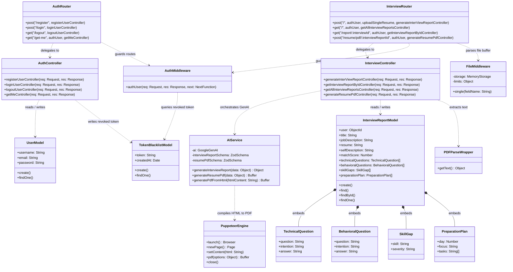
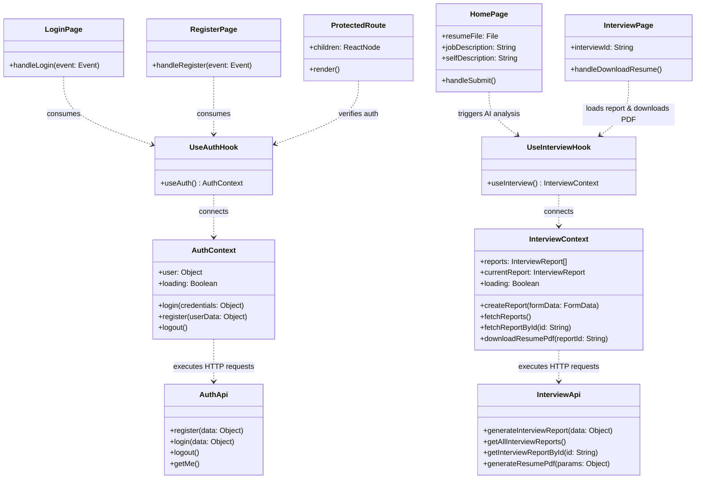

# Interview AI — Class Diagrams & System Architecture

> **Architecture Style**: Layered MVC & Service-Oriented Backend with Component-Hook-Context Frontend Architecture.

---

## 1. Backend Class & Module Architecture

---

## 2. Frontend React Architecture

---

## 3. Design Patterns Employed

1. **Layered Architecture (Separation of Concerns)**:
   - Routes handle URL matching and route-level middlewares.
   - Controllers handle HTTP validation, status codes, and request/response coordination.
   - Services contain third-party external integrations (Google GenAI, Puppeteer, PDF-Parse).
   - Models handle database schemas, validations, and Mongoose query executions.

2. **Schema-Enforced Generative AI Pattern**:
   - `GoogleGenAI` prompts are mapped with `Zod` models converted via `zod-to-json-schema`.
   - Forces deterministic, parseable, and strongly-typed JSON outputs matching internal application schemas.

3. **In-Memory File Processing**:
   - Resumes are handled in-memory via `multer.memoryStorage()`, parsed on the fly with `pdf-parse`, and never written to temporary disk space, eliminating disk I/O latency and security risks.

4. **React Context & Custom Hook Pattern**:
   - Encapsulates state, caching, and network requests cleanly inside decoupled context providers (`AuthContext`, `InterviewContext`) consumed via standard hooks (`useAuth`, `useInterview`).
