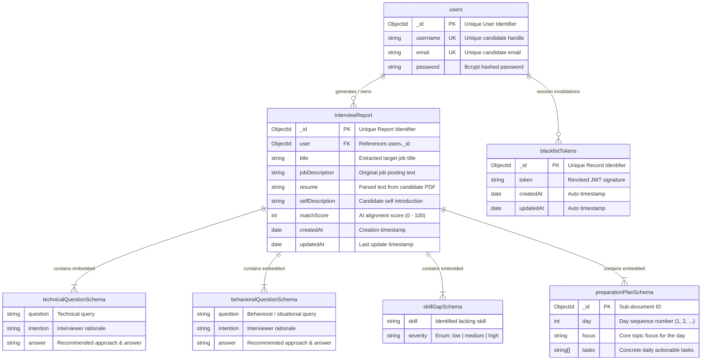

# Interview AI — Database Entity-Relationship Diagram (ERD)

> **Database**: MongoDB  
> **ODM**: Mongoose  
> **Design Pattern**: Document model with embedded sub-documents for report items and reference-based relationships for user ownership.

---

## 1. Entity-Relationship Diagram



---

## 2. Collection Schemas & Detailed Specifications

### 2.1 `users` Collection
Stores registered user credentials.

| Field | Type | Required | Constraints | Description |
| :--- | :--- | :--- | :--- | :--- |
| `_id` | `ObjectId` | Yes | Primary Key | MongoDB generated unique identifier. |
| `username` | `String` | Yes | Unique | Handle chosen by user during registration. |
| `email` | `String` | Yes | Unique | User email address used for login. |
| `password` | `String` | Yes | Bcrypt Hash | Salted and hashed password string. |

---

### 2.2 `blacklistTokens` Collection
Maintains invalid/revoked JWT tokens from user logout events to prevent session replay attacks.

| Field | Type | Required | Description |
| :--- | :--- | :--- | :--- |
| `_id` | `ObjectId` | Yes | Unique blacklist entry ID. |
| `token` | `String` | Yes | Raw JWT string invalidated upon logout. |
| `createdAt` | `Date` | Auto | Timestamp when token was blacklisted. |
| `updatedAt` | `Date` | Auto | Timestamp of last modification. |

---

### 2.3 `InterviewReport` Collection
Stores the complete AI evaluation, parsed candidate data, and roadmap plans generated by Google Gemini.

| Field | Type | Required | Constraints | Description |
| :--- | :--- | :--- | :--- | :--- |
| `_id` | `ObjectId` | Yes | Primary Key | Report unique identifier. |
| `user` | `ObjectId` | Yes | Foreign Key | References `users._id` who requested the report. |
| `title` | `String` | Yes | — | Job title derived from the job description. |
| `jobDescription` | `String` | Yes | — | Full job description text submitted by the user. |
| `resume` | `String` | No | — | Plaintext parsed from the uploaded PDF resume. |
| `selfDescription` | `String` | No | — | Candidate self-summary or bio. |
| `matchScore` | `Number` | Yes | Min: 0, Max: 100 | Percentage score indicating candidate compatibility. |
| `technicalQuestions` | `Array` | Yes | Embedded Sub-schema | Array of technical questions, intents, and solutions. |
| `behavioralQuestions`| `Array` | Yes | Embedded Sub-schema | Array of behavioral questions, intents, and solutions. |
| `skillGaps` | `Array` | Yes | Embedded Sub-schema | Missing competencies rated by severity. |
| `preparationPlan` | `Array` | Yes | Embedded Sub-schema | Day-by-day prep curriculum with specific tasks. |
| `createdAt` | `Date` | Auto | — | Date and time when report was generated. |
| `updatedAt` | `Date` | Auto | — | Last modification timestamp. |

---

### 2.4 Embedded Sub-Document Schemas

#### Technical Question Schema (`_id: false`)
```json
{
  "question": "String (Required)",
  "intention": "String (Required)",
  "answer": "String (Required)"
}
```

#### Behavioral Question Schema (`_id: false`)
```json
{
  "question": "String (Required)",
  "intention": "String (Required)",
  "answer": "String (Required)"
}
```

#### Skill Gap Schema (`_id: false`)
```json
{
  "skill": "String (Required)",
  "severity": "String (Enum: ['low', 'medium', 'high'], Required)"
}
```

#### Preparation Plan Schema
```json
{
  "_id": "ObjectId",
  "day": "Number (Required)",
  "focus": "String (Required)",
  "tasks": ["String (Required)"]
}
```
