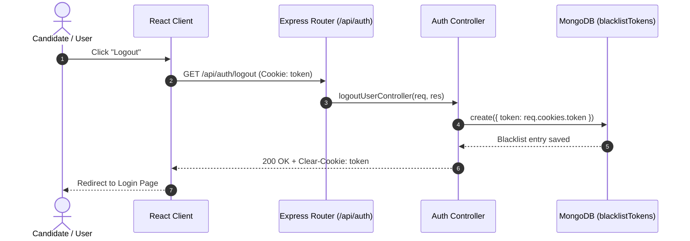
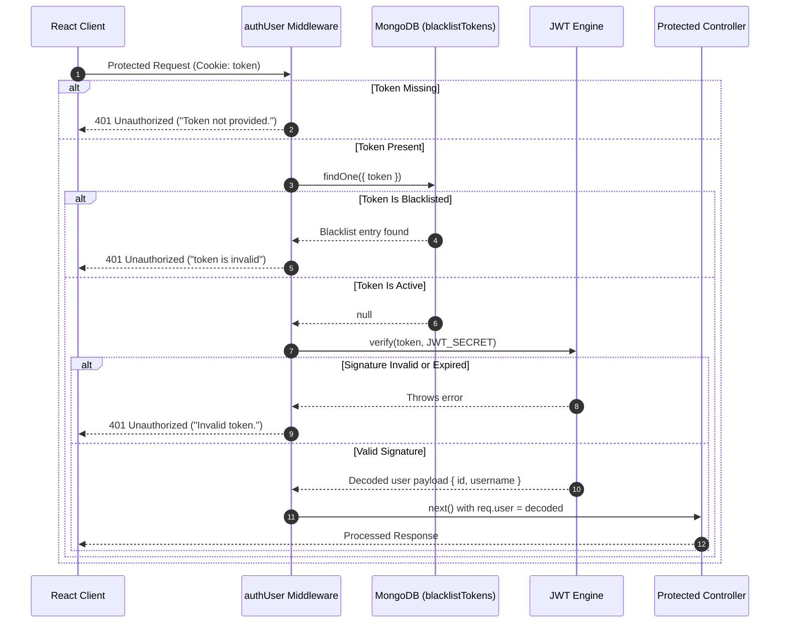
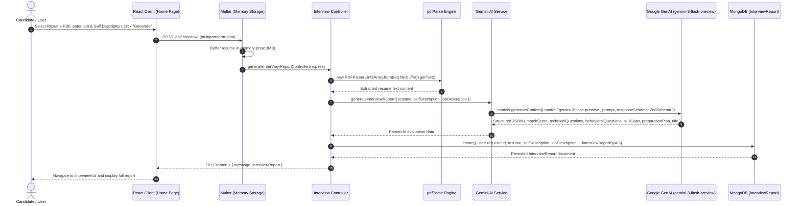
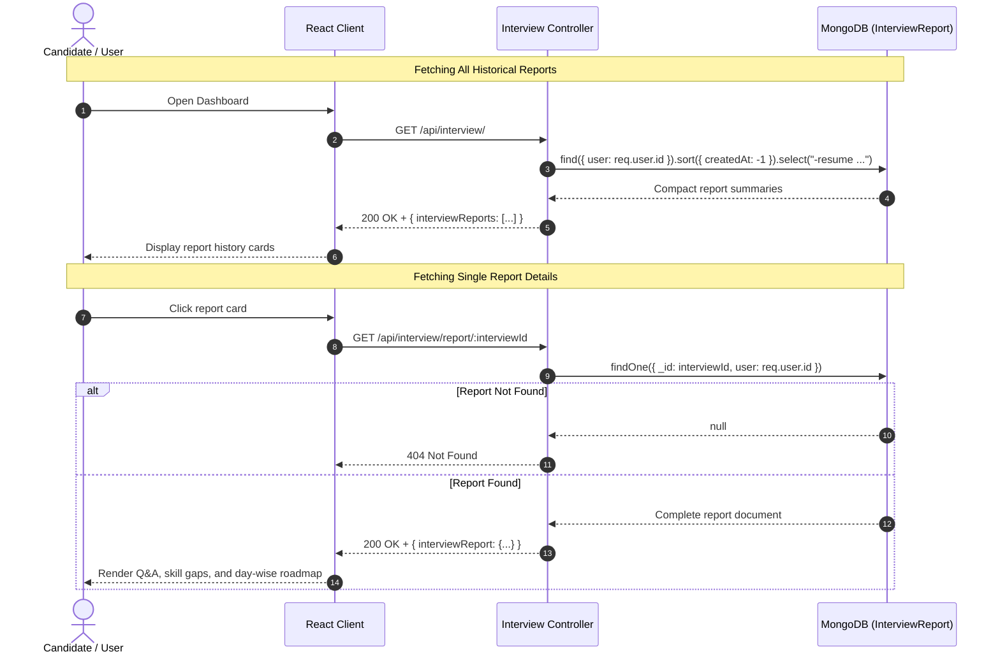
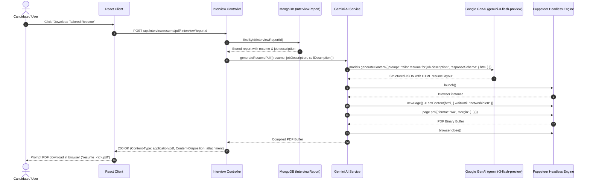

# Interview AI — System Sequence Diagrams

> Visualizing end-to-end communication flows across Client (React 19), Express Backend, Middlewares, MongoDB, Google Gemini AI, and Puppeteer.

---

## 1. User Registration & Cookie Initialization

```mermaid
sequenceDiagram
    autonumber
    actor User as Candidate / User
    participant Frontend as React Client
    participant AuthRouter as Express Router (/api/auth)
    participant AuthController as Auth Controller
    participant UserModel as MongoDB (users)
    participant JWT as JWT Engine

    User->>Frontend: Enter username, email, password & submit
    Frontend->>AuthRouter: POST /api/auth/register { username, email, password }
    AuthRouter->>AuthController: registerUserController(req, res)
    AuthController->>UserModel: findOne({ $or: [ { username }, { email } ] })
    
    alt User Already Exists
        UserModel-->>AuthController: Existing user document
        AuthController-->>Frontend: 400 Bad Request ("Account already exists...")
        Frontend-->>User: Display error message
    else New User
        UserModel-->>AuthController: null
        AuthController->>AuthController: bcrypt.hash(password, 10)
        AuthController->>UserModel: create({ username, email, password: hash })
        UserModel-->>AuthController: Saved user instance
        AuthController->>JWT: sign({ id: user._id, username }, JWT_SECRET, { expiresIn: '1d' })
        JWT-->>AuthController: Generated token string
        AuthController-->>Frontend: 201 Created + Set-Cookie: token=<jwt>; HttpOnly
        Frontend-->>User: Redirect to Dashboard / Home
    end
```

---

## 2. User Login & Session Verification

```mermaid
sequenceDiagram
    autonumber
    actor User as Candidate / User
    participant Frontend as React Client
    participant AuthRouter as Express Router (/api/auth)
    participant AuthController as Auth Controller
    participant UserModel as MongoDB (users)
    participant JWT as JWT Engine

    User->>Frontend: Enter credentials & submit
    Frontend->>AuthRouter: POST /api/auth/login { email, password }
    AuthRouter->>AuthController: loginUserController(req, res)
    AuthController->>UserModel: findOne({ email })

    alt User Not Found
        UserModel-->>AuthController: null
        AuthController-->>Frontend: 401 Unauthorized ("Invalid credentials")
    else User Exists
        UserModel-->>AuthController: User document with password hash
        AuthController->>AuthController: bcrypt.compare(password, user.password)
        alt Password Mismatch
            AuthController-->>Frontend: 401 Unauthorized ("Invalid credentials")
        else Password Valid
            AuthController->>JWT: sign({ id: user._id, username }, JWT_SECRET, { expiresIn: '1d' })
            JWT-->>AuthController: Generated token
            AuthController-->>Frontend: 200 OK + Set-Cookie: token=<jwt>; HttpOnly
            Frontend-->>User: Authenticated view rendered
        end
    end
```

---

## 3. User Logout & Token Blacklisting



---

## 4. Protected Route Interception (Auth Middleware)



---

## 5. End-to-End Interview Report Generation



---

## 6. Report Listing and Detailed View Retrieval



---

## 7. ATS Resume PDF Tailoring & Compilation


