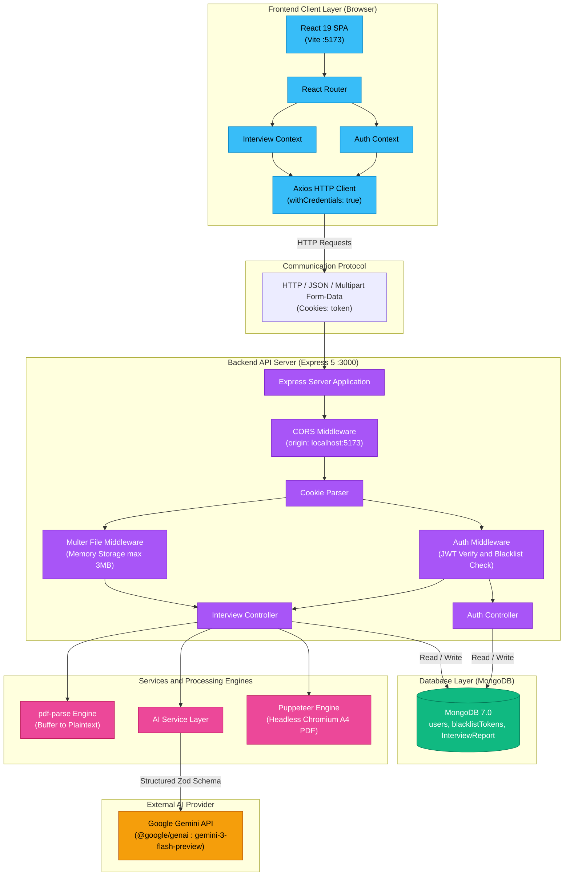
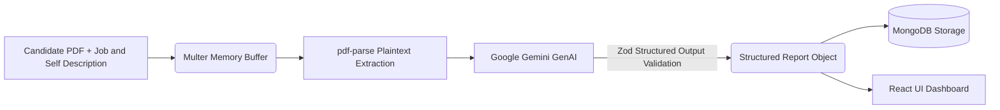
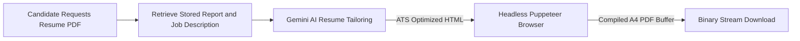

# Interview AI — System Architecture Overview

> **Architecture Style**: Decoupled Client-Server SPA Architecture with Cloud GenAI Integration and Headless Browser PDF Engine.

---

## 1. System Architecture Diagram

---

## 2. Component Breakdown & Responsibilities

| Subsystem | Core Technologies | Port / Location | Responsibility |
| :--- | :--- | :--- | :--- |
| **Frontend SPA** | React 19, React Router, Vite, Sass, Axios | `:5173` | User interface, state management via Context API, protected routes, file selection, and dynamic report visualization. |
| **Backend REST API** | Node.js, Express 5, Mongoose | `:3000` | REST API routing, cookie verification, bcrypt hashing, in-memory file buffering, and database transactions. |
| **Auth Subsystem** | JWT, Cookie-Parser, MongoDB Blacklist | `/api/auth` | User registration, login credentials verification, session cookie management, and secure logout invalidation. |
| **Interview Subsystem**| Multer, pdf-parse, Mongoose | `/api/interview` | Handles candidate upload requests, parses PDF streams, queries historical summaries, and serves report details. |
| **GenAI Service** | `@google/genai`, Zod, `zod-to-json-schema` | `src/services/ai.service.js` | Constructs optimized prompts for Gemini (`gemini-3-flash-preview`), enforcing strict JSON schema contracts for compatibility scores, Q&A, and study plans. |
| **PDF Compilation** | Puppeteer (Headless Chromium) | `generatePdfFromHtml` | Synthesizes tailored HTML resumes and compiles them into downloadable A4 PDF documents. |
| **Database** | MongoDB 7.0 | `mongodb://localhost:27017` | Persistent storage for users, blacklisted tokens, and structured interview reports. |

---

## 3. End-to-End Data Flow Architecture

The primary value chain in Interview AI consists of three interconnected data flows:

### 3.1 Report Generation Pipeline

1. **Upload & Ingestion**: Candidate selects their resume PDF (max 3MB), pastes the target job description, and provides a self-description in the React UI.
2. **In-Memory Text Parsing**: Express receives `multipart/form-data`. `Multer` stores the buffer in RAM (never written to disk). `pdf-parse` extracts clean plaintext.
3. **GenAI Schema Evaluation**: The prompt is dispatched to `gemini-3-flash-preview` along with a Zod-generated JSON schema. Gemini returns a validated JSON object with match score, questions, skill gaps, and preparation roadmap.
4. **Persistence & Presentation**: The report is saved to MongoDB linked to the candidate's ID and returned to the frontend for interactive exploration.

---

### 3.2 Tailored Resume PDF Compilation Pipeline

1. **Trigger**: Candidate clicks "Download Tailored Resume" from an existing interview report.
2. **AI Resume Drafting**: Gemini writes a professional, ATS-optimized single/double page HTML document highlighting relevant projects and skills aligned with the job description.
3. **Headless Compilation**: Puppeteer launches an isolated browser page, injects the HTML layout, renders standard A4 print margins, and compiles the binary PDF buffer.
4. **Stream & Download**: The server streams the binary buffer with `Content-Type: application/pdf` directly to the client browser.

---

## 4. Technology Stack Matrix

| Tier | Technology | Version | Purpose & Justification |
| :--- | :--- | :--- | :--- |
| **Frontend** | React | `^19.3.1` | Modern declarative UI with improved rendering and hooks. |
| **Build Tool** | Vite | `^8.3.5` | Fast HMR and lightweight frontend asset compilation. |
| **Styling** | Sass (SCSS) | `^1.107.1` | Modular SCSS styling with variables, nesting, and mixins. |
| **Routing** | React Router | `^8.5.1` | Client-side routing with protected route guards. |
| **Backend** | Express | `^5.3.0` | Latest Express web framework with native Promise error handling. |
| **Database** | MongoDB / Mongoose | `^9.11.4` | Flexible schema definition for nested interview report sub-documents. |
| **Security** | JSON Web Tokens | `^9.0.3` | Stateless session verification stored in HTTP-Only cookies. |
| **Security** | Bcrypt.js | `^3.0.3` | Industry-standard password salting and hashing (10 rounds). |
| **AI Integration**| `@google/genai` | `^2.32.0` | Official Google GenAI SDK powering Gemini 3 Flash. |
| **Validation** | Zod & zod-to-json-schema | `^4.6.7` | Strong type checking and guaranteed schema compliance for AI outputs. |
| **File Parsing** | Multer & pdf-parse | `^2.5.0` / `^2.4.5` | In-memory PDF reception and text extraction. |
| **PDF Engine** | Puppeteer | `^25.16.0` | Headless Chromium rendering engine for ATS PDF synthesis. |

---

## 5. Security & Session Architecture

* **Cookie-Based JWT Strategy**:
  - The JWT is transmitted exclusively via `httpOnly` cookies (`token`).
  - Mitigates Cross-Site Scripting (XSS) attacks by keeping the secret inaccessible to client-side JavaScript.
* **Token Blacklisting**:
  - Upon logout, the active token is inserted into the `blacklistTokens` collection.
  - The `authUser` middleware queries this collection before validating JWT claims, guaranteeing immediate revocation without waiting for the 24-hour expiration.
* **Resource Isolation & Ownership**:
  - All report detail fetches (`GET /api/interview/report/:interviewId`) filter by both `_id: interviewId` and `user: req.user.id`, ensuring candidates cannot access other users' interview reports.
