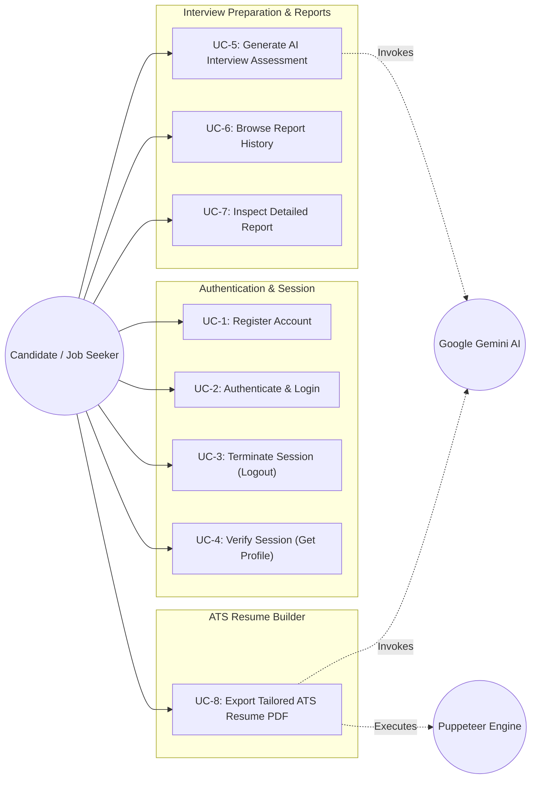

# Interview AI — Use Cases

> Detailed functional use cases, actor interactions, pre/post-conditions, and execution paths for Interview AI.

---

## 1. System Actors

| Actor | Type | Description |
| :--- | :--- | :--- |
| **Candidate / Job Seeker** | Primary Actor | End-user who registers, submits resumes and job requirements, reads interview preparation reports, and downloads tailored resumes. |
| **Google Gemini GenAI** | External Actor | Cloud LLM service (`gemini-3-flash-preview`) providing candidate evaluation and tailoring HTML resumes via structured Zod schemas. |
| **Puppeteer Engine** | Internal Service | Automated headless Chromium runtime compiling HTML into downloadable A4 PDF documents. |
| **MongoDB Database** | Internal Store | Persistent data store managing user accounts, token blacklists, and historical interview reports. |

---

## 2. Use Case Diagrams

---

## 3. Detailed Use Case Specifications

---

### UC-1: Register New Account
* **Primary Actor**: Candidate
* **Preconditions**: Candidate is on the registration page and unauthenticated.
* **Trigger**: Candidate enters `username`, `email`, and `password` and clicks "Register".
* **Main Success Scenario**:
  1. System checks that `username` and `email` are not currently in use.
  2. System salts and hashes the password with `bcrypt` (10 rounds).
  3. System creates a new user document in MongoDB.
  4. System signs a JWT containing the user ID and username.
  5. System sends a `201 Created` HTTP response setting the `token` in an `httpOnly` cookie.
  6. Frontend redirects user to Dashboard.
* **Alternative Flows**:
  * *4a. Missing Fields*: System returns `400 Bad Request` ("Please provide username, email and password").
  * *4b. Duplicate Account*: If username or email exists, system returns `400 Bad Request` ("Account already exists...").

---

### UC-2: Authenticate & Login
* **Primary Actor**: Candidate
* **Preconditions**: User has an existing registered account.
* **Trigger**: Candidate submits email and password on `/login`.
* **Main Success Scenario**:
  1. System searches for the user by email in the database.
  2. System compares the plain password with the stored bcrypt hash.
  3. On match, system generates a signed JWT (1-day expiration).
  4. System attaches the JWT to the `token` HTTP-Only cookie.
  5. System returns `200 OK` with user details.
* **Alternative Flows**:
  * *2a. Invalid Credentials*: If email is not found or password does not match, system returns `401 Unauthorized`.

---

### UC-3: Terminate Session (Logout)
* **Primary Actor**: Candidate
* **Preconditions**: Candidate is logged in with an active `token` cookie.
* **Trigger**: Candidate clicks "Logout".
* **Main Success Scenario**:
  1. Frontend sends `GET /api/auth/logout`.
  2. System retrieves the `token` cookie.
  3. System saves the token string into the `blacklistTokens` collection.
  4. System clears the `token` cookie on the client.
  5. System returns `200 OK` ("Logged out successfully").
  6. Frontend resets authentication context and navigates to `/login`.

---

### UC-4: Verify Session (`/get-me`)
* **Primary Actor**: Candidate / Frontend Route Guard
* **Preconditions**: Client has made an initial page load.
* **Trigger**: Application mounts and invokes `getMe()` to check authentication state.
* **Main Success Scenario**:
  1. `authUser` middleware checks if `token` cookie exists.
  2. Middleware asserts the token is NOT in `blacklistTokens`.
  3. Middleware verifies JWT signature and extracts user payload.
  4. Route controller returns `200 OK` with `{ user: { id, username } }`.
* **Alternative Flows**:
  * *1a. Token Missing or Invalid*: System returns `401 Unauthorized`. Frontend directs user to login.

---

### UC-5: Submit Resume & Generate AI Assessment
* **Primary Actor**: Candidate
* **Supporting Actor**: Google Gemini GenAI
* **Preconditions**: Candidate is logged in.
* **Trigger**: Candidate fills in Job Description, Self Description, uploads a `.pdf` resume (max 3MB), and clicks "Generate Interview Report".
* **Main Success Scenario**:
  1. Frontend submits a `multipart/form-data` request to `POST /api/interview/`.
  2. `Multer` accepts the upload into an in-memory buffer.
  3. `pdf-parse` extracts raw text from the buffer.
  4. System builds an evaluation prompt and invokes `GoogleGenAI` (`gemini-3-flash-preview`) with a strict Zod JSON schema.
  5. Gemini returns a structured JSON payload containing:
     - `matchScore` (0 to 100).
     - `technicalQuestions` (question, intention, recommended answer).
     - `behavioralQuestions` (question, intention, recommended answer).
     - `skillGaps` (skill, severity: `low` | `medium` | `high`).
     - `preparationPlan` (day number, focus, tasks list).
     - `title` (extracted job role).
  6. System creates a new `InterviewReport` in MongoDB referencing `req.user.id`.
  7. System returns `201 Created` with the complete report object.
  8. Frontend navigates to `/interview/:interviewId` to display the assessment.
* **Alternative Flows**:
  * *2a. File Too Large*: If file exceeds 3MB, Multer rejects request with an error.
  * *4a. Gemini API Error*: Returns `500 Server Error` if API key is invalid or request fails.

---

### UC-6: Browse Report History
* **Primary Actor**: Candidate
* **Preconditions**: Candidate is logged in and visits the Dashboard/Home.
* **Trigger**: Component calls `getAllInterviewReports()`.
* **Main Success Scenario**:
  1. System queries `InterviewReport` filtered by `user: req.user.id`.
  2. System sorts reports descending by `createdAt: -1`.
  3. System projects only lightweight metadata fields (`_id`, `title`, `matchScore`, `createdAt`), omitting heavy question/text fields for performance.
  4. System returns `200 OK` with `interviewReports` array.
  5. Frontend displays a list of clickable report cards.

---

### UC-7: Inspect Detailed Report
* **Primary Actor**: Candidate
* **Preconditions**: Candidate is logged in and selects a specific report from history.
* **Trigger**: User navigates to `/interview/:interviewId`.
* **Main Success Scenario**:
  1. Frontend calls `GET /api/interview/report/:interviewId`.
  2. System queries MongoDB for `_id: interviewId` AND `user: req.user.id`.
  3. System returns `200 OK` with all technical questions, behavioral questions, skill gap badges, and the day-wise roadmap.
  4. Frontend renders the structured dashboard.
* **Alternative Flows**:
  * *2a. Report Not Found / Unauthorized*: If report ID does not exist or belongs to another user, system returns `404 Not Found`.

---

### UC-8: Export Tailored ATS Resume PDF
* **Primary Actor**: Candidate
* **Supporting Actors**: Google Gemini GenAI, Puppeteer Engine
* **Preconditions**: An interview report has been successfully generated.
* **Trigger**: User clicks "Download Tailored Resume" button on report page.
* **Main Success Scenario**:
  1. Frontend issues `POST /api/interview/resume/pdf/:interviewReportId` with `responseType: "blob"`.
  2. System retrieves the stored report (resume plaintext, job description, self description).
  3. System prompts Google Gemini to write an ATS-optimized, modern single/double-page HTML resume tailored specifically for the target job description.
  4. Gemini returns JSON with the compiled `html` string.
  5. System launches a headless **Puppeteer** browser instance.
  6. Puppeteer creates a new page, injects HTML content, and renders an A4 PDF with 20mm/15mm margins.
  7. System closes the Puppeteer browser instance.
  8. System sends the PDF binary buffer with `Content-Type: application/pdf` and `Content-Disposition: attachment; filename=resume_<id>.pdf`.
  9. Candidate browser triggers a direct file download.
* **Alternative Flows**:
  * *5a. Puppeteer Rendering Failure*: Browser instance is closed safely, and system returns `500 Server Error`.
