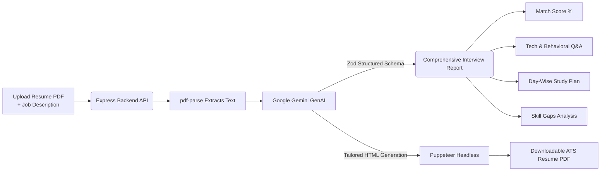

# 🎯 Interview AI — GenAI Interview Preparation & ATS Resume Builder

[](https://react.dev/)
[](https://vitejs.dev/)
[](https://nodejs.org/)
[](https://www.mongodb.com/)
[](https://ai.google.dev/)
[](https://pptr.dev/)

**Interview AI** is an end-to-end full-stack GenAI application designed to help job seekers crack technical interviews. By analyzing the candidate's existing resume, self-description, and target job description, the platform leverages **Google Gemini AI** to generate structured interview reports, identify skill gaps, provide tailored preparation schedules, and render ATS-friendly customized PDF resumes on the fly.

---

## 🚀 Key Features

- **📊 AI Profile-to-Job Match Scoring**: Calculates a percentage-based match score indicating how well a candidate's profile aligns with the target job requirements.
- **💡 Targeted Technical & Behavioral Questions**:
  - Predicts real-world interview questions tailored to the position.
  - Explains the **interviewer's intent** behind each question.
  - Suggests high-impact, structured sample answers and approaches.
- **⚠️ In-Depth Skill Gap Analysis**: Highlights missing or underdeveloped skills, categorized by impact severity (`low`, `medium`, `high`).
- **📅 Day-by-Day Preparation Roadmap**: Delivers a structured, daily study plan with concrete tasks and topics to prepare before the interview.
- **📄 Instant ATS Resume PDF Generation**:
  - Leverages Google Gemini to re-structure and tailor resume content for the exact job description.
  - Uses **Puppeteer** to compile clean HTML into an ATS-friendly, professional A4 PDF ready for download.
- **🔒 Secure Authentication & Token Blacklisting**: JWT-based authentication stored in HTTP-only cookies with server-side token blacklisting for safe logouts.

---

## 🛠️ Tech Stack

### Frontend
- **Framework**: [React 19](https://react.dev/) with [Vite](https://vitejs.dev/)
- **Routing**: [React Router](https://reactrouter.com/)
- **Styling**: Sass / SCSS (Modern modular design)
- **State Management**: React Context API (`AuthContext`, `InterviewContext`)
- **HTTP Client**: [Axios](https://axios-http.com/) with cookie credential support

### Backend
- **Runtime**: [Node.js](https://nodejs.org/) with [Express 5](https://expressjs.com/)
- **Database & ODM**: [MongoDB](https://www.mongodb.com/) with [Mongoose](https://mongoosejs.com/)
- **AI Engine**: [Google GenAI SDK](https://www.npmjs.com/package/@google/genai) (`@google/genai`)
- **Schema Validation**: [Zod](https://zod.dev/) & [zod-to-json-schema](https://www.npmjs.com/package/zod-to-json-schema) for structured Gemini outputs
- **File & PDF Processing**: [Multer](https://www.npmjs.com/package/multer), [pdf-parse](https://www.npmjs.com/package/pdf-parse), and [Puppeteer](https://pptr.dev/)
- **Security**: [bcryptjs](https://www.npmjs.com/package/bcryptjs), [jsonwebtoken](https://www.npmjs.com/package/jsonwebtoken), [cookie-parser](https://www.npmjs.com/package/cookie-parser), [cors](https://www.npmjs.com/package/cors)

---

## 📂 Project Architecture

```
GenAI-Project/
├── Backend/
│   ├── src/
│   │   ├── config/             # MongoDB connection logic
│   │   ├── controllers/        # Route handlers (auth, interview)
│   │   ├── middlewares/        # Auth & Multer file upload middlewares
│   │   ├── models/             # Mongoose schemas (User, InterviewReport, Blacklist)
│   │   ├── routes/             # Express API routes
│   │   ├── services/           # Gemini AI prompt engine & Puppeteer PDF generator
│   │   └── app.js              # Express app setup & middleware configuration
│   ├── .env.example            # Backend environment template
│   ├── package.json
│   └── server.js               # Entry point
│
├── Frontend/
│   ├── src/
│   │   ├── features/
│   │   │   ├── auth/           # Login, Register, Auth Context & Services
│   │   │   └── interview/      # Home, Interview Report, Context & SCSS
│   │   ├── style/              # Global variables and mixins
│   │   ├── App.jsx             # Main component tree
│   │   ├── app.routes.jsx      # Route definitions
│   │   └── main.jsx            # React root mounting
│   ├── package.json
│   └── vite.config.js
│
├── .gitignore
└── README.md
```

---

## ⚙️ Getting Started

### Prerequisites

Ensure you have installed:
- [Node.js](https://nodejs.org/) (v18.0.0 or higher recommended)
- [MongoDB](https://www.mongodb.com/) (Local instance or [MongoDB Atlas](https://www.mongodb.com/cloud/atlas))
- A [Google AI Studio API Key](https://aistudio.google.com/) for Gemini access

---

### 1. Clone the Repository

```bash
git clone https://github.com/Shivam-S-Ramoliya/Gen-AI-Project.git
cd Gen-AI-Project
```

---

### 2. Backend Setup

1. Navigate to the backend directory:
   ```bash
   cd Backend
   ```

2. Install dependencies:
   ```bash
   npm install
   ```

3. Create your `.env` file from the provided `.env.example`:
   ```bash
   cp .env.example .env
   ```

4. Configure your `.env` variables:
   ```env
   PORT=3000
   MONGO_URI=mongodb://localhost:27017/genai-interview
   JWT_SECRET=your_super_secret_jwt_key
   GOOGLE_GENAI_API_KEY=your_gemini_api_key_here
   ```

5. Start the backend development server:
   ```bash
   npm run dev
   ```
   *The backend will be live at `http://localhost:3000`.*

---

### 3. Frontend Setup

1. Open a new terminal and navigate to the frontend directory:
   ```bash
   cd Frontend
   ```

2. Install dependencies:
   ```bash
   npm install
   ```

3. Start the Vite development server:
   ```bash
   npm run dev
   ```
   *The application will be accessible at `http://localhost:5173`.*

---

## 📡 API Endpoints Reference

### 🔐 Authentication (`/api/auth`)

| Method | Endpoint | Access | Description |
| :--- | :--- | :--- | :--- |
| `POST` | `/api/auth/register` | Public | Register a new user (`username`, `email`, `password`) |
| `POST` | `/api/auth/login` | Public | Authenticate user & issue JWT HTTP-only cookie |
| `GET` | `/api/auth/logout` | Private | Invalidate session & blacklist token |
| `GET` | `/api/auth/get-me` | Private | Retrieve authenticated user profile |

### 📋 Interview Preparation & Resumes (`/api/interview`)

| Method | Endpoint | Access | Description |
| :--- | :--- | :--- | :--- |
| `POST` | `/api/interview/` | Private | Generate report (`multipart/form-data`: `resume`, `selfDescription`, `jobDescription`) |
| `GET` | `/api/interview/` | Private | Fetch all interview reports created by the user |
| `GET` | `/api/interview/report/:interviewId` | Private | Fetch details of a specific interview report |
| `POST` | `/api/interview/resume/pdf/:interviewReportId` | Private | Generate and download an ATS-tailored resume PDF |

---

## 💡 How It Works



---

## 🤝 Contributing

Contributions, issues, and feature requests are welcome!
Feel free to check the [issues page](https://github.com/Shivam-S-Ramoliya/Gen-AI-Project/issues).

---

## 📝 License

This project is licensed under the [MIT License](LICENSE).
